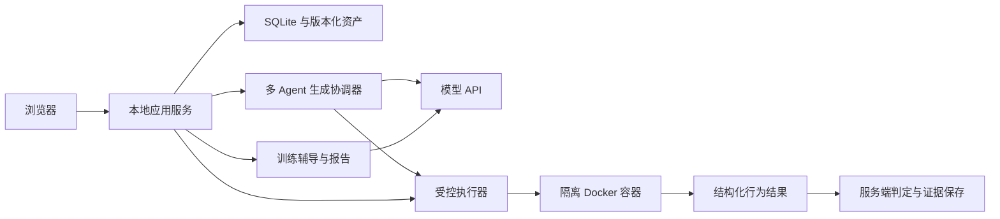

# 架构与执行边界

[返回首页](README.md) · [多 Agent 协作](docs/MULTI_AGENT.md) · [生成流程](docs/FAULT_FIRST.md)

AgentLab V0.5 是本地单用户应用，连接题目生成、审核发布和工程训练。生成与训练复用同一套文件权限、Docker 执行和版本化证据机制。

## 系统组成

| 层次 | 实现 | 职责 |
| --- | --- | --- |
| 界面 | React、TypeScript、Vite、Monaco Editor | 导航、生成进度、代码编辑、对话与报告 |
| 应用服务 | FastAPI、Pydantic | API、权限校验、阶段调度、模型适配与发布 |
| 持久化 | SQLite 与版本化文件 | 会话、调用、执行记录、任务资产与代码快照 |
| 执行环境 | 固定 Python Docker 镜像 | 隔离运行任务代码，返回结构化行为结果 |
| 模型服务 | 兼容 Chat Completions 的 API | 项目生成、独立评测、教学与训练辅导 |

服务默认监听回环地址，后端采用单进程运行。当前没有账号隔离或多机器调度，不应直接作为公网多人服务部署。

## 多 Agent 生成

生成侧包含项目构建、评测和教学三个角色，由程序串行调度。角色可以使用同一个模型，各阶段重新构造上下文，通过结构化资产和执行证据交接。

- **构建**：设计公开规范与故障项目；故障验收通过后生成修复补丁及规避版本。
- **评测**：审查规范、独立生成测试与故障复现检查；发现缺项或失败时补测、修正获准修改的评测资产，或将具体问题交回构建。
- **教学**：验证通过后生成题面、三级提示与追问材料。

初次测试生成不读取实现；故障复现检查不读取实际输出；失败分析可以读取实现与执行证据。程序校验引用、修改范围、版本与预算，并执行候选。模型的判断不能直接将验证状态改为通过。

当前新任务采用精简规范审查和具体场景覆盖复查，不运行强制需求清单 DSL 与重复采纳审查链。历史任务依据已保存的协议继续处理，避免改变已有资产语义。

## 训练与快照

每次训练从固定任务版本创建独立工作副本。文件 API、编辑器与 Agent 工具共用 manifest 权限；保存时提交全部可编辑文件，再生成不可变快照。

多文件摘要包含任务 ID、版本以及按路径排序的文件内容，也包含只读运行入口。旧单文件任务保留原摘要算法。快照只读挂载到容器，执行记录关联实际运行的快照。

提交重新执行公开和隐藏行为检查，并保存提交时的诊断说明与提示记录。报告从这些固定证据生成；后续编辑、聊天与提示不会改变历史报告。

## 不可信代码与判分

任务代码始终在 Docker 中执行。宿主只运行平台维护的评测逻辑，不导入或执行用户、模型生成的 Python 模块。

| 执行约束 | 当前设置 |
| --- | --- |
| 身份与权限 | 非 root、丢弃 capabilities、禁止提权 |
| 网络与文件系统 | 无网络、只读根文件系统、只读挂载本次快照 |
| 资源 | 128 MiB 内存、0.5 CPU、32 个进程上限 |
| 临时存储 | 容器内 `/tmp`，16 MiB |
| 时间与输出 | 默认每检查 8 秒，输出上限 32 KiB |
| 隔离内容 | 不挂载 Docker socket、模型密钥、隐藏评测源码或其他会话 |

固定题使用可信行为断言；生成题使用经过程序校验的 JSON 输入与期望值，由可信解释器比较返回结果。任务打印的 `PASS`、日志或分数不参与判分。生成题的期望值来自模型，仍须人工审核其正确性。

每次场景调用使用独立容器。两次重复执行可检查结果是否一致，但不会共享可写状态。单次调用内的 `save/load` 和返回文本也不能单独证明跨进程持久化；这类训练目标需要能观察到相应差异的接口与测试。

## 辅导与报告

学习者对话由单个训练 Agent 负责，可读取允许的文件、diff、公开测试与会话证据。它不能直接写代码，也不能通过工具读取参考修复、隐藏测试源码或服务端配置。L1–L3 提示由用户请求逐级开放，上限由服务端校验。

报告将客观评测与模型反馈分别保存。反馈仅使用本次提交证据，显示生成中、成功或失败；模型失败不丢失客观结果。报告保留受控输出预算、超时和最多一次输出耗尽重试，不进行无限调用。

Markdown 使用安全渲染，工具原始数据默认折叠。用户代码产生的轨迹是调查线索，不能作为独立可信的通过证明。

## 持久化、恢复与发布

默认数据目录为 `data/`，可通过 `AGENTLAB_DATA` 配置。

| 路径 | 内容 |
| --- | --- |
| `app.sqlite3` | 任务索引、会话、调用、运行与报告记录 |
| `workspaces/` | 各会话的工作副本与保存修订 |
| `snapshots/` | 内容寻址的执行快照 |
| `runs/` | 训练执行输出与中断标记 |
| `generation/` | 生成阶段输入、响应、资产与验证文件 |
| `published/` | 审核发布后的冻结任务包 |

重启后，无法继续的生成与训练执行会标为中断；未完成的报告反馈标为失败并注明中断。恢复生成需显式操作，不在启动时悄悄重复模型调用。

发布要求完整验证通过、教学材料就绪，以及作者对当前资产摘要的明确批准。发布时再次核对摘要并保存冻结清单；重复发布返回已有实例。新版本另建资产，旧会话继续关联原版本。

备份时先停止服务，再复制整个数据目录。只复制 SQLite 会丢失代码与执行证据。本地所有者可以检查源码与私有资产；作者与学习者视图的隔离不等同于防范本机所有者。

## 相关实现

- [文件权限与快照](backend/workspace.py)
- [容器执行器](backend/executor.py)
- [生成协调器](backend/generation_fault_first.py)
- [精简审查与覆盖复查](backend/generation_lean.py)
- [生成资产校验](backend/generation_schema.py)
- [安装与验收](README.md#检查安装)
