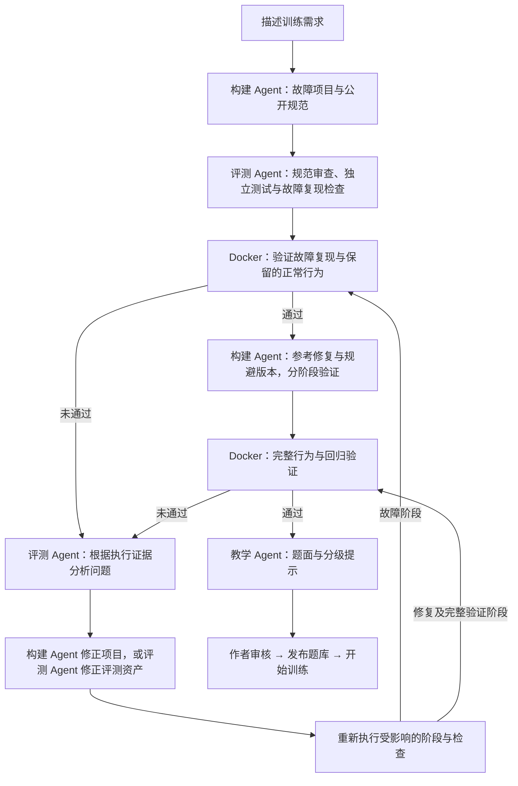

# AgentLab · V0.5

**面向 Agent 开发的工程实操训练平台。**

从一个故障场景出发，阅读代码、定位问题、修改实现，在真实执行中验证判断。也可以描述想练习的工程问题，由多个 Agent 协作构建、评测和修正，生成经过实际执行验证与人工审核的训练项目。

[快速开始](#快速开始) · [训练流程](#训练流程) · [生成题目](#生成题目) · [技术文档](#技术文档)

## 功能概览

| 板块 | 可以做什么 |
| --- | --- |
| **题库** | 选择内置任务或已发布的生成任务，开始训练、继续已有会话、查看历史报告。 |
| **故障题目生成** | 描述需求，由多个 Agent 协作生成项目、独立评测与自动修复，审核后发布到题库。 |
| **个人工程项目训练** | 尚未开放，当前不支持导入个人项目或仓库。 |

训练工作区提供多文件代码编辑、公开测试、Agent 对话、三级提示和提交评测。报告将测试结果与模型反馈分开展示，并关联提交时的代码快照、诊断说明和提示记录。

### 内置任务

| 任务 | 训练重点 |
| --- | --- |
| RAG 重排后的引用错位 | 检索结果、重排与引用的一致性 |
| 工具超时重试导致重复执行 | 重试策略与幂等语义 |
| Agent 中断恢复后重复执行步骤 | 状态持久化与流程恢复 |
| 知识库更新后的旧版本污染 | 跨模块排查、索引更新与版本管理 |

## 快速开始

### 1. 准备环境

- Linux、macOS，或 Windows WSL2；使用 Bash 执行以下命令。
- Python 3.10+、Node.js 22.12+、npm。
- Docker Engine 或 Docker Desktop，支持 Linux 容器，当前用户运行 `docker info` 成功。
- 支持 Chat Completions 和工具调用的模型 API，用于题目生成、训练对话与报告反馈。

### 2. 初始化并配置模型

在项目根目录执行。首次初始化需要联网安装依赖与构建运行镜像。

```bash
cp -n .env.example .env
./scripts/init.sh
```

编辑 `.env`，填写自己的模型配置：

```dotenv
AGENT_MODE=real
MODEL_BASE_URL=https://your-provider.example/v1
MODEL_NAME=your-model-name
MODEL_API_KEY=your-api-key
```

`MODEL_BASE_URL` 填写 API 根地址，程序自动追加 `/chat/completions`。模型调用会产生供应商费用；密钥只保存在本地后端，不要提交到仓库。更多可选配置见 [.env.example](.env.example)。

### 3. 启动

```bash
./scripts/start.sh
```

打开 **[http://127.0.0.1:5173](http://127.0.0.1:5173)**，默认进入故障题目生成，可通过顶部导航切换到题库。使用 `Ctrl+C` 停止服务；修改模型配置后需要重启。

## 训练流程

1. **选择题目**：阅读场景、公开行为要求和修改范围，创建独立训练会话。
2. **调查与修改**：新会话默认打开 `任务说明.md`，集中查看题面、环境约束并填写诊断说明。项目文件与公开测试可在标签页中打开；保存操作会保存全部编辑文件。
3. **运行验证**：点击“保存并运行公开测试”，查看行为检查、失败详情和执行记录。
4. **获取辅导**：让 Agent 检查已保存代码和测试证据，或按需获取 L1–L3 提示。Agent 不会直接替你修改代码。
5. **提交评测**：填写诊断说明，点击“保存并提交评测”。系统针对本次快照重新执行公开和隐藏检查。
6. **回顾报告**：查看客观结果、模型反馈和对应提交代码；之后的编辑与提示不会改变已有报告。

诊断说明建议包含：**观察到什么、如何定位、为什么这样修复、验证了哪些场景**。没有提供说明时，报告无法评价你的定位过程与技术取舍。

生成历史与训练历史默认收起，展开后可继续已有记录。已保存会话和报告可在刷新后恢复；未保存的训练草稿保存在当前浏览器中。模型暂时不可用时，代码编辑、Docker 测试与客观评测仍可使用，反馈失败会单独显示。

## 生成题目

在“故障题目生成”中描述希望练习的场景、异常现象与关键约束。例如：

> 本地工具完成写入后响应丢失，客户端重试造成重复记录。我希望练习排查与修复这类问题，同时保留暂时性失败后的重试能力。

### 多 Agent 协作

三个 Agent 角色由程序按阶段调度，通过项目资产、修改要求和执行证据交接，共同完成生成与纠错。

| Agent | 主要职责 | 发现问题后的处理 |
| --- | --- | --- |
| **项目构建 Agent** | 设计公开规范、构建故障项目，生成参考修复与规避版本 | 根据反馈修改获准调整的代码或规范，保留当前阶段要求的故障与正常行为。 |
| **评测 Agent** | 审查规范，独立生成行为测试与故障复现检查，分析执行失败 | 补充缺失测试、纠正获准修改的评测资产；实现问题交回构建 Agent，规范问题退回审查与补齐。 |
| **教学 Agent** | 验证通过后生成题面、分级提示与教学材料 | 根据材料校验反馈修正内容，保持与任务规范和验证结果一致。 |

各阶段使用独立上下文：初次行为测试不读取实现，失败分析可以查看代码和执行证据。评测 Agent 同时承担**验证与评测纠错**职责；测试修订必须有规范依据并经过程序校验，不能仅因实现未通过就修改正确期望。

### 生成与修复流程

当前流程采用**先验证故障，再生成修复**，每轮修改都回到对应验证阶段：



修复在限定预算与修改权限内进行。页面显示进度、用量和具体失败原因；遇到需澄清、预算耗尽或无法继续的问题，会保留记录并提供相应恢复入口。训练工作区的日常辅导由单个训练 Agent 负责。

生成范围为 **Python 标准库小型多模块项目、本地数据与模拟工具**，可围绕 RAG、工具调用、上下文、工作流、权限等 Agent 工程场景提出需求。生成期间离开页面不会取消服务端任务。

**自动检查通过后仍需人工审核。** 作者应核对题面、测试期望、故障机制、参考修复与验证范围，填写审核依据并勾选确认后，点击“添加至题库”。勾选本身不会发布题目。发布后训练使用冻结的任务资产，不会每次重新生成；私有审核材料与学习者界面分离。

## 数据与使用范围

- **本地单用户**：当前面向本机使用，不提供账号体系、多人服务或公网部署方案。
- **隔离执行**：任务代码仅在受限 Docker 容器中运行，默认无网络。Docker 不可用时禁用执行，不降级到宿主机。
- **数据保存**：默认在 `data/` 保存会话、任务资产、执行记录与快照。这些数据与 `.env`、本地验证记录不随源码发布；从仓库下载不会带入他人的生成或训练历史。迁移或备份时请保留整个数据目录；浏览器中的未保存草稿需先保存。
- **验证边界**：测试通过只说明通过了本次检查，不能证明覆盖所有边界；模拟场景不代表真实外部系统已得到验证。训练报告不预测招聘结果。

升级后如需更新执行镜像，停止服务并运行以下命令，再重新启动。保留原有 `.env` 和 `data/`。

```bash
docker build -t agentlab-runner:0.1 -f backend/Dockerfile .
./scripts/start.sh
```

## 检查安装

完成初始化后，可在项目根目录检查运行环境、测试与构建：

```bash
.venv/bin/python scripts/docker_check.py
./scripts/test.sh
```

需要完整浏览器验收时，先停止日常前后端服务，释放 8000 与 5173 端口，再执行：

```bash
frontend/node_modules/.bin/playwright install chromium
./scripts/acceptance.sh
```

检查实际结果中的失败、跳过与缺失项目。浏览器验收使用隔离数据和明确标识的模型替身，任务代码仍在 Docker 中执行；它不等同于真实模型生成能力验证。验收输出仅保存在本地 `data/acceptance/`。

## 技术文档

前端采用 React、TypeScript 与 Monaco Editor；后端采用 FastAPI、SQLite 与 Docker。

- [Docker 配置与排障](docs/DOCKER_SETUP.md)
- [界面与工作区使用指南](docs/WORKSPACE.md)
- [架构与执行边界](ARCHITECTURE.md)
- [多 Agent 协作与自动修复](docs/MULTI_AGENT.md)
- [任务包与多文件权限](docs/TASK_PACKAGES.md)
- [生成资产与版本格式](docs/GENERATION_FORMAT.md)
- [故障优先生成流程](docs/FAULT_FIRST.md)
