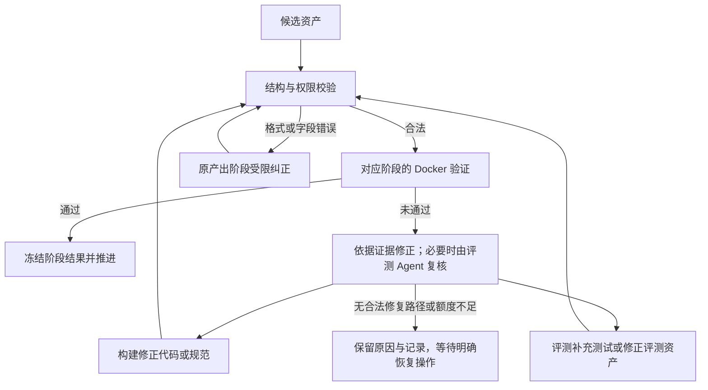

# 故障优先生成流程

[返回首页](../README.md) · [Agent 分工](MULTI_AGENT.md) · [资产格式](GENERATION_FORMAT.md)

当前新任务先构建并验收故障项目，再生成参考修复。这样可以先固定练习中的错误行为，再验证修复是否消除该故障并满足公开要求。

## 完整流程

| 步骤 | 负责方 | 产物与推进条件 |
| --- | --- | --- |
| 1. 项目设计与构建 | 构建 Agent | 根据需求生成公开规范、故障项目与私有故障设计；程序校验接口、文件和结构 |
| 2. 规范审查 | 评测 Agent | 核对核心需求、正常行为与可验证性；缺项退回构建，用户目标有歧义时提出问题 |
| 3. 独立测试 | 评测 Agent | 根据公开规范生成输入与正确期望，不读取实现 |
| 4. 覆盖复查 | 评测 Agent | 检查具体场景，选择通过、追加测试或退回规范问题 |
| 5. 故障复现检查 | 评测 Agent | 根据冻结设计确定错误行为及逐场景影响范围，不读取实际输出 |
| 6. 故障验收 | Docker 与程序判定 | 复现预设故障，验证未受影响的正常行为与重复执行一致性；通过后冻结基线 |
| 7. 修复验收 | 构建 Agent、Docker | 对冻结基线生成局部修复补丁，验证全部正确行为及故障消除 |
| 8. 规避与完整验证 | 构建 Agent、Docker | 构造典型错误修复，执行正常、故障、参考与规避版本的检查矩阵 |
| 9. 教学与发布 | 教学 Agent、作者 | 生成题面和三级提示；作者核对当前资产与证据，明确批准后发布 |

当前正常版与参考修复可以由同一份已验收修复代码提供，不应将它们计作两个独立生成实现。

## 失败后的协作

验证不通过时，程序保存失败检查、实际行为和版本绑定。可修正的实现问题交回构建；评测 Agent 负责失败复核、补测以及授权范围内的评测纠错。修改后的候选必须重新验证。

故障阶段的代码纠正需要保留预设故障及正常回归；修复阶段才消除故障。测试正确期望以公开规范为依据，不能以参考实现的实际输出代替标准。

规范、接口或故障设计发生获准变更时，相关资产需要重新生成或验证。已冻结基线不能静默修改；已发布实例只能通过新版本更新。

## 如何理解验证结果

| 检查 | 证明范围 |
| --- | --- |
| 正常版、参考修复通过 | 对本轮测试输入满足正确期望 |
| 故障复现通过 | 有效输出命中预先定义的错误行为；异常、超时或空输出不算复现 |
| 正常回归与影响范围通过 | 本轮检查中需要保留的行为及字段符合要求 |
| 规避检查通过 | 指定错误候选被目标检查拒绝，同时保留必要的正常行为 |
| 重复执行一致 | 相同输入的独立执行输出一致，不证明所有输入都确定 |

覆盖复查是模型意见。`covers` 标签、轨迹或“已保存”等文本不能替代行为证据。测试容量有限，也可能漏掉接口允许但尚未构造的组合。

例如，两个工作流先后完整运行不一定证明状态隔离；一次进程内调用保存与读取不一定证明持久化。作者审核应核对场景是否确实能区分错误实现与正确实现。

## 状态与恢复

页面展示准备项目、生成评测、验证与修复、准备训练材料、待审核和已发布等阶段。失败还会区分环境阻塞、供应商问题、中断、预算耗尽或需人工复核。

点击恢复前先查看具体原因。恢复已有批次消耗剩余预算，新批次需明确授权；旧失败记录保留。自动修复受总预算和阶段次数限制，不保证所有问题都能被模型自行解决。

当前新任务使用精简流程 `lean-generation-v1`，结合 `fault-first-v1` 与逐场景影响检查。旧记录按持久化协议运行，可能展示不同阶段；不自动迁移历史资产或改写报告。
